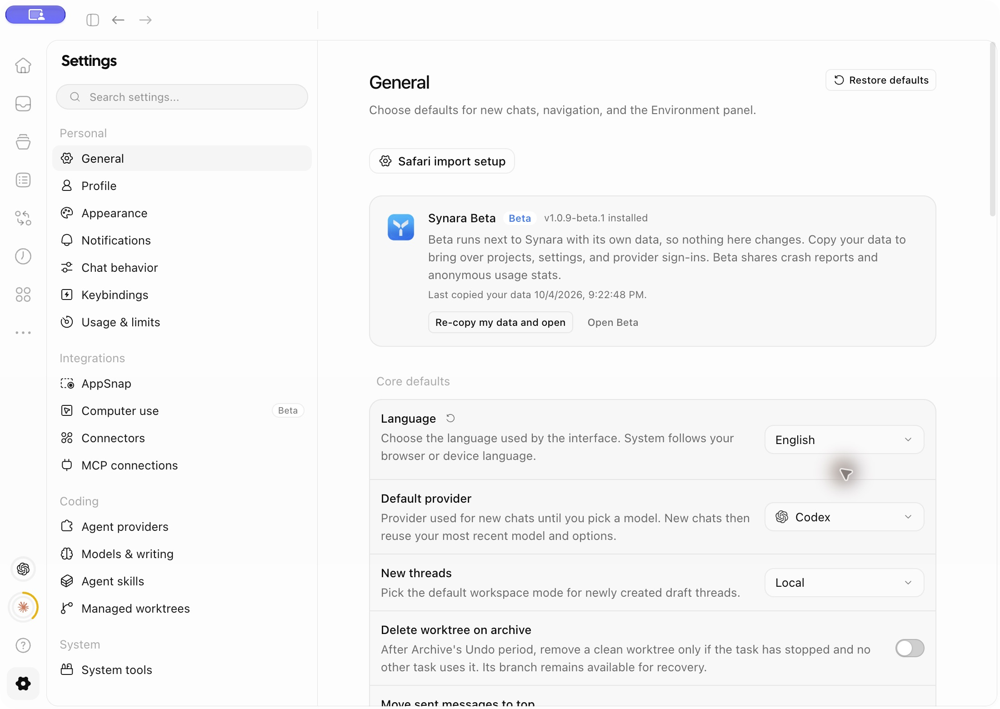
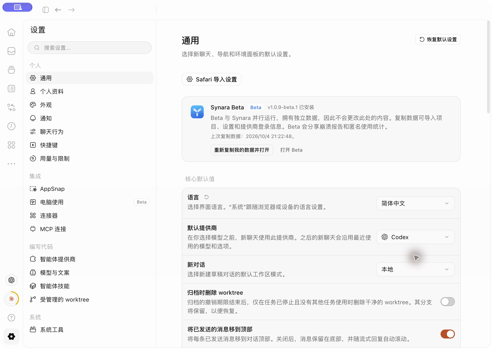
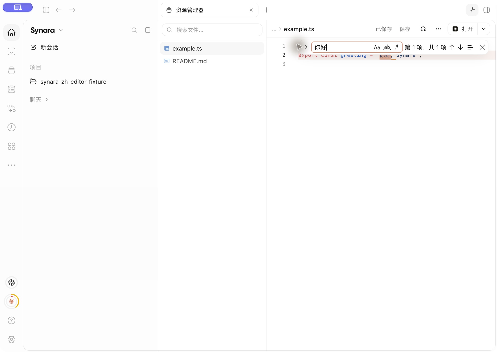
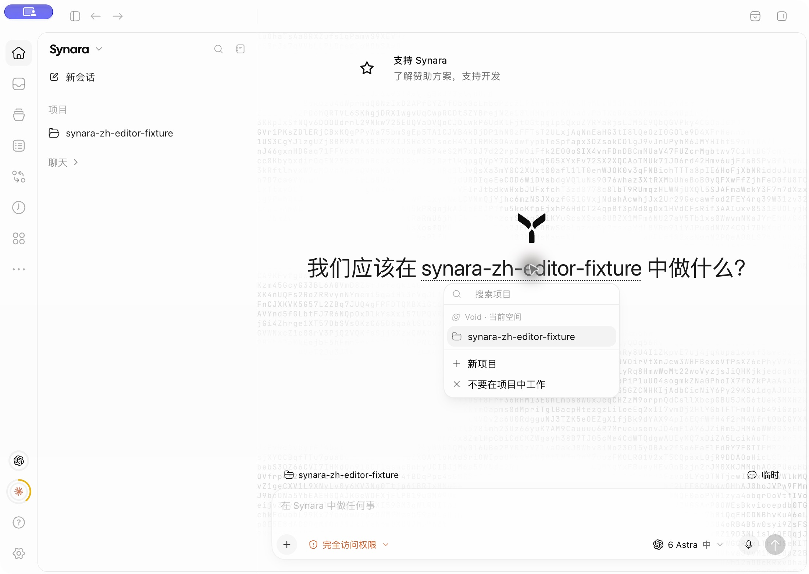

# Chinese language support: visual evidence

Captured from the verified local macOS desktop build with an isolated test profile on 27 October 2026. These are English/Chinese comparisons of the same implementation, not screenshots of two different commits.

| Before choosing Chinese                   | After choosing Chinese                               |
| ----------------------------------------- | ---------------------------------------------------- |
|  |  |

The editor and project picker were captured after the final copy fixes. The fixture filename, source text, and project name remain unchanged.

These captures demonstrate the local macOS build. They do not establish packaged Windows/Linux behavior, signed-release behavior, or the language of actual macOS permission prompts.
