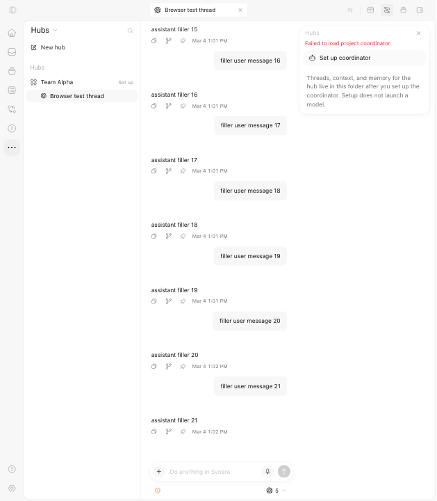

# PR #2023 visual evidence

The before image uses the original PR head `71f7c64a84a889c67065fd0547db418aaa816f08`; the after image and recording use repaired head `1e9ace7bec2beeded38f80432387ad29dfed7416`.

| Before: Hub exposes an unrelated project action | After: Hub preserves its navigation |
| ----------------------------------------------- | ----------------------------------- |
|                        |              |

[13-second Chromium recording](home-new-thread-and-hub.webm): Home's + action opens a draft in the latest ordinary project; without a project it opens Create project; Hub does not expose that action. Supporting states: [project draft](home-project-draft.png), [Create project](home-create-project.png).

Three browser cases passed using production components and CSS with isolated fixture data. This is UI evidence, not live-provider qualification. The Hub fixture retains its existing coordinator-loading error. Only leading compilation and trailing cleanup were trimmed; no UI was recreated or composited. Recording instrumentation was removed and the implementation worktree remained clean. Source pins, media hashes and dimensions are in [manifest.json](manifest.json).
