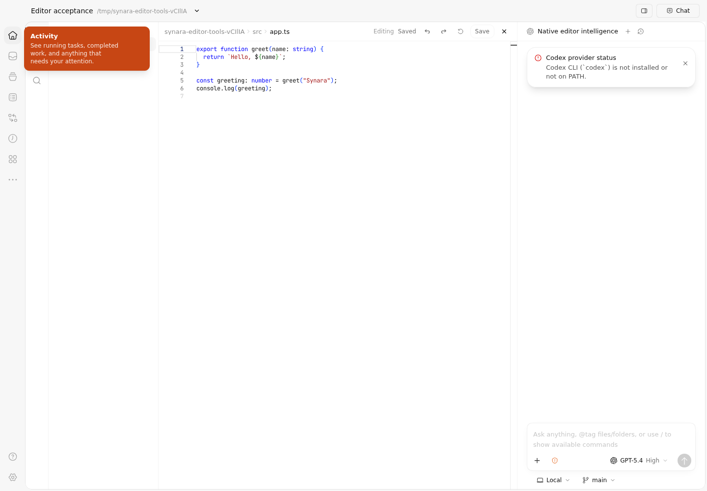
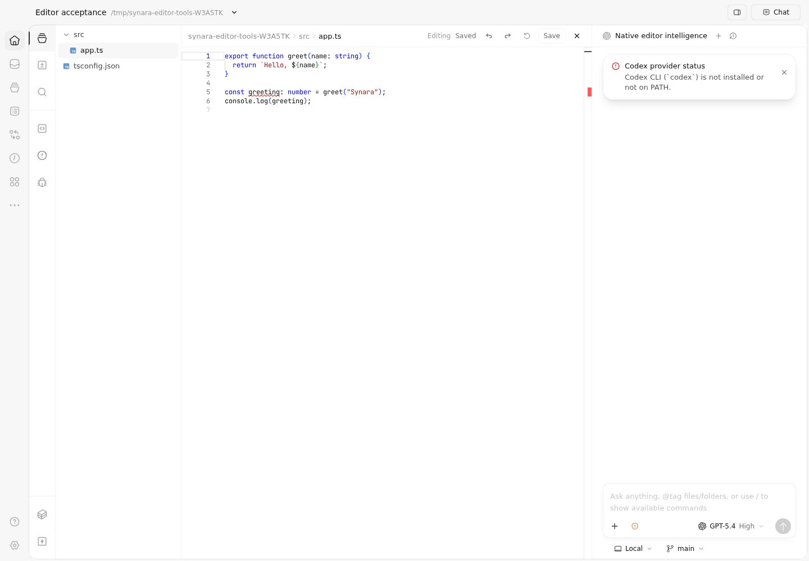
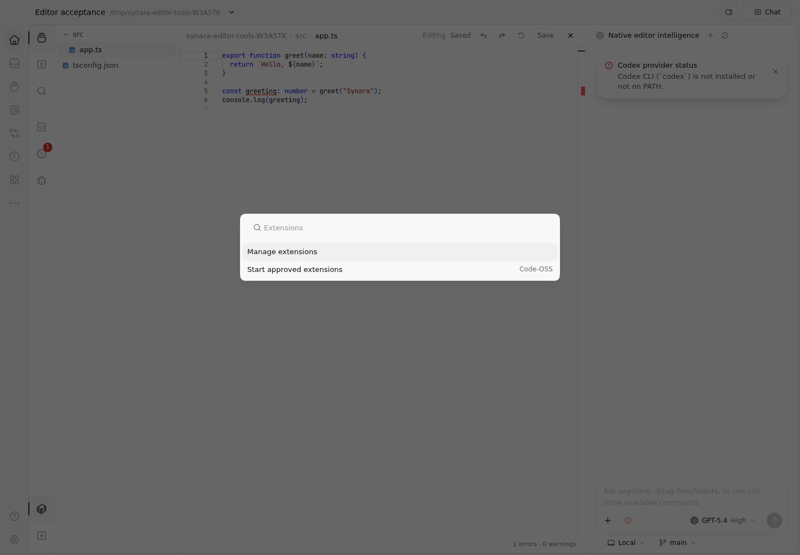

# Native editor rail evidence

These are unmodified screenshots captured by Playwright from real Synara instances with isolated data homes and the same TypeScript workspace fixture. They are not generated mockups. Only the existing inner editor rail is extended; the outer application navigation is unchanged.

## Before

Application revision: `7cfd39f9fd7790f24abe7a061ab31fe6fb5d54a9`. The [baseline run](https://github.com/Emanuele-web04/synara/actions/runs/38867116068) used the same journey with its baseline flag and confirmed the original three buttons.

## After

Application candidate: `dd99a44e5d9c07d8092d58f635f48f4b6e0e7e37`. The [successful native journey](https://github.com/Emanuele-web04/synara/actions/runs/38868827134) verified eight buttons, keyboard activation, real document symbols and TypeScript diagnostics, the existing debugger launch dialog, editor commands, compact viewport reachability and navigation to the existing extension Settings. The workspace file remained unchanged. The artifact also retains a video and the other journey captures.

Formatting, lint, the integrated typecheck, scope ownership tests and existing shell/editor browser regressions passed in the baseline run's `checks` job. Its original journey assertion and the next attempt's modal assertion were corrected in the test only; no production behavior was weakened to accommodate them. The successful final run above contains those test corrections. The publication adds only permanent acceptance wiring and this evidence to the verified application candidate.

Run the current journey from the repository root with `cd apps/web && ./node_modules/.bin/playwright test --config playwright.editor-tools.config.ts`. Use the repository's required Node/Bun toolchain and install Chromium with the existing `test:browser:install` script first. The harness starts its own servers and never connects to a user's running Synara instance. Artifact retention is finite; the checked-in PNGs preserve this specific comparison.

This rail change does not certify the remaining Code-OSS runtime/platform requirements. PR 2 remains draft with the compatibility limits in [extensions.md](../extensions.md).
