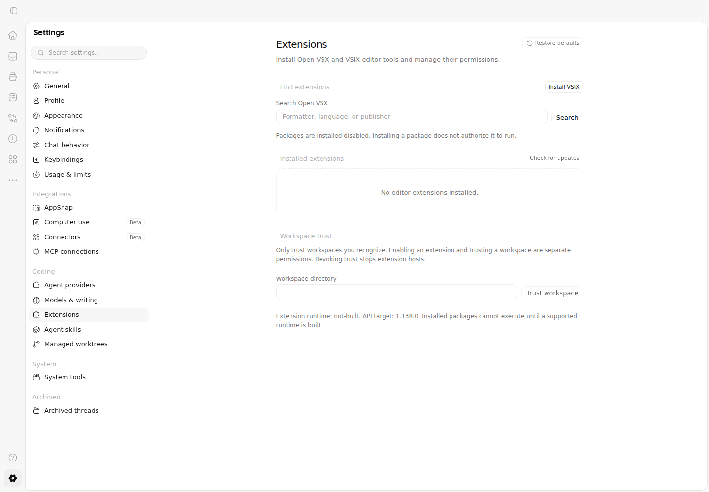
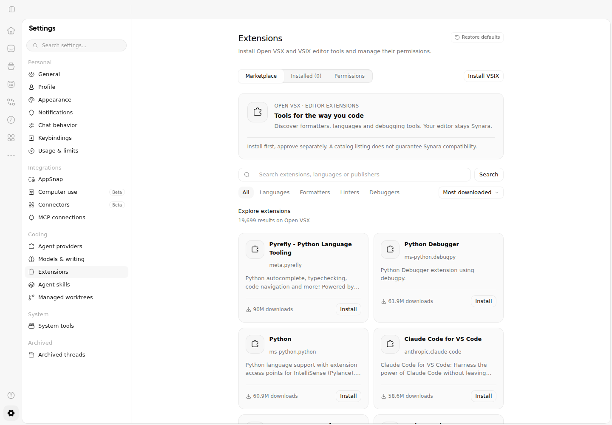
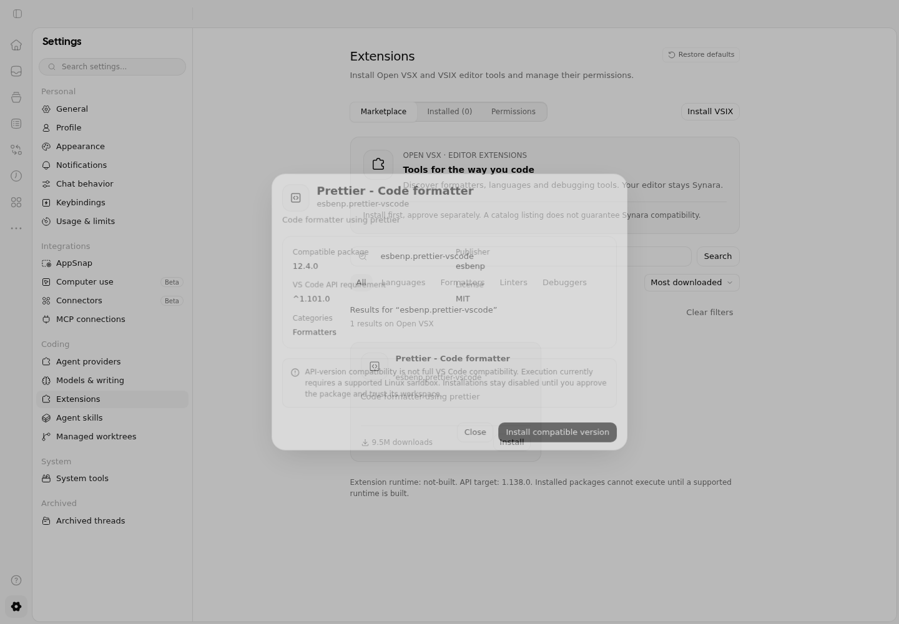
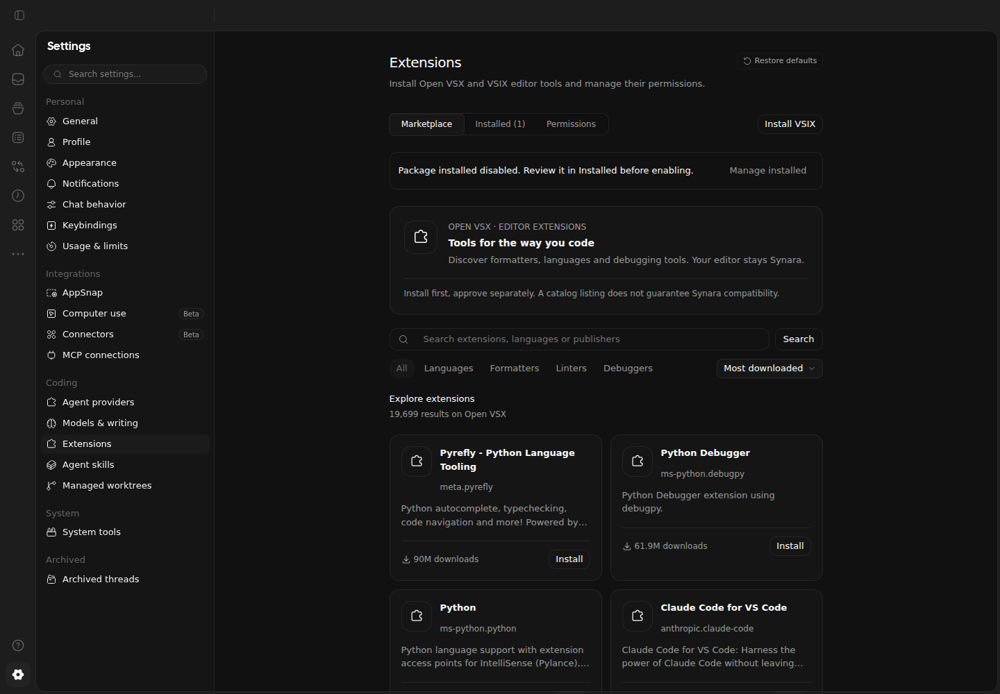

# Native marketplace acceptance

This evidence covers the user-authorized marketplace in Settings → Extensions, not universal extension compatibility or completion of every release gate in PR #1952. The existing editor rail opens the same Settings surface. No parallel workbench, explorer, terminal or Git panel was introduced.

## Candidate and environment

Application candidate: `91208de08c13b18961def5bb8d8fc747f4dc6cf2`. Its application code is the code published with these captures; publication additionally preserves evidence and removes the temporary review workflow without rewriting history.

[Review run 38876139857](https://github.com/Emanuele-web04/synara/actions/runs/38876139857) passed on Ubuntu 24.04 with the repository-pinned Node/Bun toolchain and Chromium. All four jobs completed successfully. The run's prepare job records the tested candidate explicitly: the workflow-trigger commit is an execution bridge, not the tested application revision.

Verified: full `bun run fmt:check`, `bun run lint`, `bun run typecheck`, focused registry/catalog/package-safety Vitest tests, and native marketplace component tests. The component tests cover live-search behavior, category selection, unavailable-registry recovery, dialog focus return and installation/approval separation. They use a mocked API for deterministic interaction checks; they are not real registry or execution claims.

The separate real application journey used the actual Synara server and Open VSX, without route or RPC mocks. It verified initial discovery, a different second results page, category filtering, exact publisher-ID lookup, compatible metadata, actual Prettier package installation, the disabled/unapproved installed state, no automatic workspace trust or host execution, Permissions navigation, dark appearance, a 1024 × 768 viewport without document-level horizontal overflow, and confirmed removal. Page errors were checked. This journey does not build or run an extension host.

A real-registry incompatibility found during verification was corrected: the upstream aggregation endpoint can return a zero response offset for a requested later page. Synara retains its bounded request cursor, validates the response and tests that the actual next page contains different entries. It does not treat a zero response offset as permission to restart pagination.

## Authentic before and after

The original plain-search Settings surface was captured against `159d279515e775e94fe21e493ba31202b98a8955` in the successful baseline job of [run 38874222937](https://github.com/Emanuele-web04/synara/actions/runs/38874222937). The other jobs in that earlier run exposed defects; they are not presented as successful final verification.

Before:

After, live catalog:

After, compatible package details:

After, dark appearance:

[Installed package](./evidence/marketplace-after-installed.png) · [Compact viewport](./evidence/marketplace-after-compact.png).

These PNGs are unchanged Playwright captures of running Synara. No generated artwork or substitute VS Code screenshots were used. The [full application artifact](https://github.com/Emanuele-web04/synara/actions/runs/38876139857/artifacts/12035227833) retains the original attachments and machine-readable journey evidence for its finite retention period. Checked-in PNGs remain available with the branch. The permanent `extension-marketplace-acceptance.yml` workflow regenerates current after evidence.

## Scope and limits

The [marketplace guide](./marketplace.md) maps the implemented search, loading, feedback and focus decisions to the Apple documentation reviewed for this task and lists the reused Synara controls. This is not Apple certification. A numerical contrast audit, VoiceOver walkthrough and packaged macOS/Windows execution were not performed by this browser job. Local tool failures prevented a separate local interactive visual-review pass; the automated browser assertions and original images are the recorded evidence.

Installation, enablement and workspace trust remain distinct. Marketplace metadata does not certify a publisher or guarantee every VS Code API. Existing sandbox/platform limits in [extensions.md](./extensions.md) still apply. Broader pre-existing PR failures must be read separately from this passing marketplace candidate.
